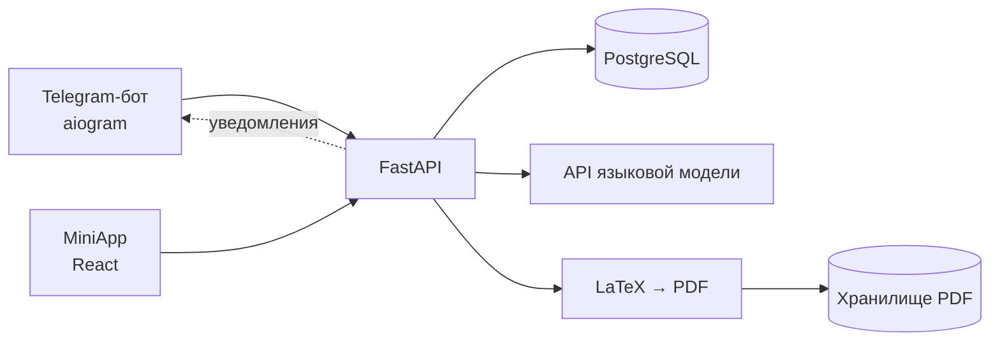
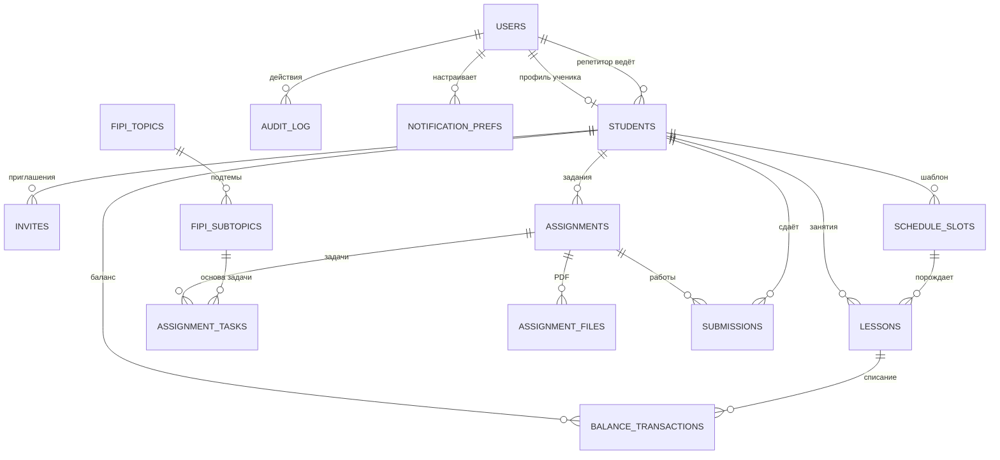
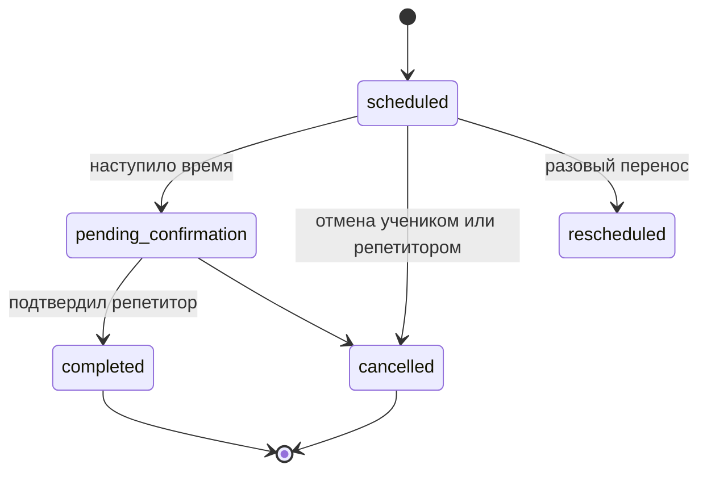
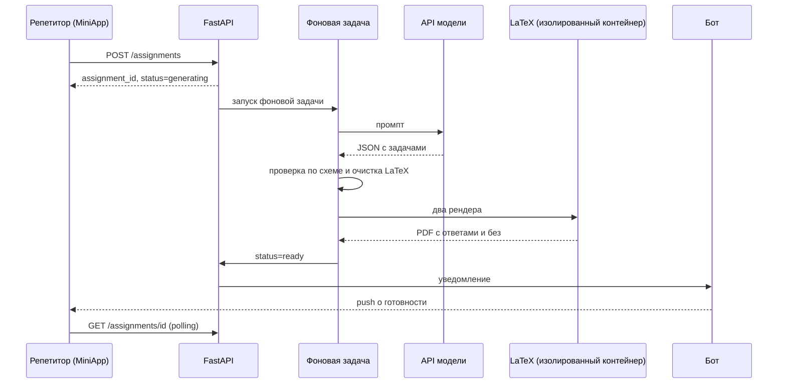

# Telegram-бот + MiniApp для репетитора с генерацией заданий через ИИ

## Содержание

1. О проекте
2. Для кого и зачем
3. Что умеет
4. Как устроена работа с ИИ
5. Технологии и архитектура
6. Модель данных
7. Вход, роли и безопасность
8. Расписание и баланс
9. Генерация заданий: техническое описание
10. API
11. Интерфейс и дизайн-система
12. Тестирование и оценка качества
13. Roadmap
14. Идеи на будущее
15. Соответствие требованиям


## 1. О проекте

Приложение для частного репетитора по математике и физике. Оно берёт на себя рутину: расписание занятий, учёт оплат и баланса, выдачу и проверку работ, а главное — **генерацию учебных заданий с помощью языковой модели**. Репетитор выбирает ученика, тип задания и тему, а через некоторое время получает готовый PDF: версию с решениями и ответами для себя и версию без ответов для ученика.

Всё живёт внутри Telegram. Бот служит точкой входа и каналом уведомлений, а основная работа идёт в Mini App — веб-интерфейсе, который открывается прямо в мессенджере. Отдельного сайта и других мессенджеров в проекте нет; ученик без Telegram в систему не попадает (по планам есть развитие в рамках отдельного сайта и входа через другие каналы).


## 2. Для кого и зачем

**Пользователи**

- **Репетитор** — главный пользователь. Ведёт учеников (ожидается 15–50), сам готовит задания и считает оплаты. Репетиторов может быть несколько, каждый видит только своих учеников. Роль запрашивается самостоятельно и активируется после одобрения администратором.
- **Ученик** — получает задания, сдаёт работы, видит расписание, может отменить занятие. Попадает в систему только по персональному приглашению своего репетитора.
- **Администратор** — владелец системы: одобряет заявки репетиторов, управляет пользователями, работает как репетитор и имеет экран самопроверки (нужен для тестирования и демонстрации).

**Какую проблему решаем**

1. Подготовка заданий занимает много времени, особенно под ОГЭ и ЕГЭ, где важно строго следовать спецификации ФИПИ.
2. Расписание, переносы и оплаты обычно ведутся в разрозненных заметках и чатах.
3. Ответы и решения нужно держать отдельно от версии для ученика, не путая их.


## 3. Что умеет

### Репетитор

- Создаёт ученика пошаговой формой: имя, способ входа, класс, предмет, график, контакт родителя, цена занятия.
- Составляет **повторяющееся расписание** (несколько слотов на неделю, разные предметы); из шаблона автоматически создаются конкретные занятия.
- Подтверждает проведённые занятия: только после этого с баланса ученика списывается занятие (откат возможен).
- Пополняет баланс («+1 занятие», «+4 занятия»), видит историю операций и задолженность.
- **Генерирует задания:** домашняя работа, тест, ОГЭ, ЕГЭ, олимпиада, свободная тема.
- Проверяет присланные работы: отметка («зачёт», «есть ошибки», «не зачёт») и комментарий.

### Ученик

- Видит присланные работы в одном списке со статусами и сдаёт свои.
- Смотрит расписание и отменяет занятие, обязательно указывая причину.
- Настраивает напоминания (за 24, 12 и 2 часа); системные уведомления отключить нельзя.

### Бот

- **Выбор роли при первом знакомстве**: незнакомому пользователю бот предлагает «Я репетитор» или «Я ученик». Репетитор подаёт заявку, которую администратор одобряет одним нажатием кнопки в боте; ученику бот объясняет, что доступ выдаёт его репетитор персональной ссылкой (раздел 7.1).
- Привязка ученика по ссылке-приглашению.
- Уведомления: напоминания, готовность или ошибка генерации, отмена занятия.
- Реакция на неожиданный ввод: короткая подсказка и кнопка открытия MiniApp.


## 4. Как устроена работа с ИИ

Это ядро проекта. Генерация построена так, чтобы результат был предсказуемым и проверяемым, а не «как получится».

1. **Асинхронный запуск.** Запрос создаёт заявку со статусом `generating` и сразу возвращает её номер. Тяжёлая работа (вызов модели и сборка PDF) идёт в фоне; о результате репетитор узнаёт push-сообщением от бота и по обновлению статуса в MiniApp.
2. **Структурированный ответ модели.** Модель возвращает не готовый документ, а JSON: условие, решение, ответ и параметры визуала. Структура проверяется по схеме, а LaTeX-фрагменты очищаются по белому списку команд до дальнейшей обработки.
3. **Типизированные визуалы.** Для каждого типа задачи заранее известно, нужен ли рисунок и какой: график функции, планиметрический чертёж, схема электрической цепи, стереометрия. Модель не рисует сама, а возвращает параметры, которые затем детерминированно превращаются в изображение.
4. **Два PDF из одной генерации.** Из одного JSON собираются версия с ответами и версия без них. Задачи в них идентичны по построению.
5. **Строгое следование ФИПИ.** Для ОГЭ и ЕГЭ репетитор выбирает номера заданий и подтемы со счётчиками. Справочник тем (метод решения, тип ответа, пример-эталон) подставляется в промпт: формулировка и числа меняются, метод и тип ответа — нет. По сути это упрощённый RAG на структурированных данных.
6. **Свободная генерация** для всего, что не укладывается в экзаменационную структуру, например «квадратичные уравнения с параметром».

Выбор конкретного провайдера и модели оставлен на финальный этап проектирования: пайплайн строится так, чтобы модель можно было заменить.


## 5. Технологии и архитектура

| Слой | Выбор | Обоснование |
|---|---|---|
| Бэкенд | Python, FastAPI, aiogram | Один сервис обслуживает бота, REST API для MiniApp, генерацию PDF и вызовы ИИ без дублирования бизнес-логики. Async из коробки, удобная проверка `initData` |
| Фронтенд | React + Vite, Telegram Mini Apps SDK | SDK лучше документирован под React; компоненты ложатся на «3 роли — 3 набора экранов» |
| База данных | PostgreSQL | При 15–50 учениках и параллельных запросах нужна транзакционная целостность, особенно для баланса; SQLite станет узким местом |
| Документы | LaTeX через `pylatex`, `tectonic` или `pdflatex` | Качественные формулы и воспроизводимая вёрстка |
| Визуалы | `matplotlib`/`pgfplots`, TikZ, circuitikz | Детерминированный рендер из параметров |
| Хранилище PDF | Файловая система или S3-совместимое | Отдельная БД для файлов не нужна |
| Запуск | Docker Compose: api, db, frontend и отдельный изолированный контейнер для сборки PDF (предложено) | Воспроизводимый запуск по инструкции; компиляция LaTeX отделена от основного сервиса по соображениям безопасности (раздел 7.4) |
| Дизайн | Figma | Готовы главная репетитора и список учеников |


### Общая схема (скелет)



### Структура репозитория (скелет)

```
backend/
  app/api/        # REST-эндпоинты для MiniApp
  app/bot/        # хендлеры aiogram
  app/models/     # таблицы и схемы
  app/services/   # расписание, баланс, генерация
  app/prompts/    # шаблоны промптов по типам заданий
  app/render/     # LaTeX-шаблоны и рендер визуалов
frontend/         # React + Vite, экраны по ролям
fipi/             # справочник тем и подтем (JSON)
docs/scenarios/   # описание каждого сценария
docker-compose.yml
README.md
```

---

## 6. Модель данных (скелет)



| Таблица | Поля | Назначение |
|---|---|---|
| `users` | `id`, `telegram_id` (уникальный), `name`, `username`, `role` (`tutor` / `admin` / `student`), `status` (`pending` / `active` / `rejected` / `blocked`), `approved_by`, `approved_at` | Аккаунт; единственный способ входа — Telegram. Один `telegram_id` — одна запись — одна роль |
| `invites` (предложено) | `id`, `student_id`, `token_hash`, `expires_at`, `used_at` | Одноразовые ссылки-приглашения |
| `students` | `id`, `tutor_id`, `user_id` (пусто до привязки), `grade`, `subjects`, `price_per_lesson`, `parent_name`, `parent_phone` | Профиль ученика; `tutor_id` — владелец карточки и основа изоляции данных между репетиторами; контакт родителя необязателен |
| `schedule_slots` | `id`, `student_id`, `weekday`, `time`, `subject` | Постоянный еженедельный шаблон |
| `lessons` | `id`, `student_id`, `slot_id` (nullable), `scheduled_at`, `status`, `cancel_reason` | Конкретные занятия; `slot_id` пуст у разовых |
| `balance_transactions` | `id`, `student_id`, `lesson_id` (nullable), `amount`, `type` (`topup` / `deduction` / `rollback`), `created_by` | Журнал баланса; `lesson_id` заполнен у списаний и откатов |
| `assignments` | `id`, `student_id`, `type` (`homework` / `test` / `oge` / `ege` / `olympiad` / `free`), `subject`, `task_count`, `deadline`, `status` (`generating` / `ready` / `failed`), `error_message`, `free_topic`, `sent_at` | Заявка на генерацию |
| `assignment_tasks` | `id`, `assignment_id`, `visual_type`, `fipi_subtopic_id` (nullable), `task_data` (json) | Отдельные задачи внутри задания |
| `assignment_files` | `id`, `assignment_id`, `file_type` (`with_answers` / `without_answers`), `file_path` | Обе версии PDF хранятся всегда |
| `submissions` | `id`, `student_id`, `assignment_id`, `file_path`, `status` (`pending` / `reviewed`), `submitted_at`, `result` (`credit` / `errors` / `fail`), `comment`, `reviewed_at` | Работы на проверку, всегда привязаны к заданию |
| `fipi_topics` | `id`, `subject`, `exam_type` (`oge` / `ege_base` / `ege_profile`), `year`, `task_number`, `topic_title` | Номера заданий экзамена |
| `fipi_subtopics` | `id`, `topic_id`, `name`, `visual_type`, `generation_hints` (json), `examples` (json) | Подтемы номера |
| `notification_prefs` | `id`, `user_id`, `role`, `type`, `enabled` | У ученика: `reminder_24h/12h/2h` (отключаемые) и `system` (всегда включён); у репетитора: `assignment_ready`, `assignment_failed` |
| `audit_log` (предложено) | `id`, `actor_user_id`, `action`, `target_type`, `target_id`, `details` (json), `created_at` | Журнал значимых действий: смена ролей, одобрения, блокировки, приглашения, операции с балансом |

Идентичность отделена от остальной схемы: все таблицы ссылаются на внутренние `users.id` и `students.id`, а не на `telegram_id`. Если ученик сменит аккаунт, меняется одно поле.


## 7. Вход, роли и безопасность

### 7.1 Роли и онбординг (предложено)

**Принципы**

1. **Один `telegram_id` — одна запись в `users` — одна роль.** Это ограничение уровня БД, а не договорённость в коде.
2. **Ученик не выбирает роль сам.** Роль «ученик» выдаётся только по персональному приглашению конкретного репетитора, поэтому нельзя подключиться к чужому репетитору или без приглашения.
3. **Репетитор запрашивает роль сам, но активируется она только после одобрения администратора** одним нажатием кнопки в боте (возможно, в будущем этого не будет, и будет полная автоматика).
4. **Администратор — единственная роль, которая задаётся конфигурацией** (`ADMIN_IDS`): это корень доверия, список короткий и почти не меняется.

**Сценарий для нового пользователя**

1. `/start` без токена, записи в `users` нет → бот предлагает выбрать: «Я репетитор» или «Я ученик».
2. «Я ученик» → бот объясняет, что доступ выдаёт репетитор персональной ссылкой; **запись не создаётся**.
3. «Я репетитор» → создаётся `users(role=tutor, status=pending)`; пользователю приходит «Заявка отправлена»; администратору в бот приходит сообщение с именем, `@username` и id и кнопками «Одобрить» / «Отклонить» / «Заблокировать».
4. «Одобрить» → `status=active`, репетитор получает уведомление и кнопку открытия MiniApp. «Отклонить» → `status=rejected`, повторная заявка возможна не раньше чем через сутки. «Заблокировать» → `status=blocked`, заявки с этого id игнорируются.
5. Пока статус `pending`, API отвечает только на проверку `initData` и запрос статуса, MiniApp показывает экран «Заявка на рассмотрении».

**Ученик по приглашению.** `/start <токен>` → если токен действителен и записи для этого `telegram_id` ещё нет, создаётся `users(role=student, status=active)` и привязывается к карточке ученика. Если запись уже есть (любая роль), бот отказывает с пояснением, а **токен не расходуется**. Человек, у которого уже есть роль репетитора, не может по ссылке стать учеником; для такого случая нужен другой Telegram-аккаунт.

**Администратор.** При каждом входе список `ADMIN_IDS` синхронизируется с БД: id в списке → `role=admin, status=active`; если запись с ролью `admin` есть, а id из списка убран, роль понижается до `tutor`. Отозвать права администратора можно правкой конфигурации.

**Корректировка ролей.** Только администратор, в разделе «Пользователи»: заблокировать, разблокировать, сменить роль. Смена роли запрещена, если у пользователя есть связанные данные (ученики у репетитора, привязанная карточка у ученика). Каждое действие записывается в `audit_log`.

**Чем это гарантируется технически**

| Правило | Как обеспечивается |
|---|---|
| Один id — одна роль | `UNIQUE(users.telegram_id)`; создание через `INSERT … ON CONFLICT DO NOTHING` и чтение результата, поэтому два одновременных `/start` не дают дубликата |
| Приглашение одноразовое | Расход токена — атомарный `UPDATE invites SET used_at = now() WHERE … AND used_at IS NULL AND expires_at > now() RETURNING …` в одной транзакции с созданием пользователя и привязкой |
| Кнопки одобрения нельзя подделать | Сервер сам проверяет, что нажавший (`from_user.id`) входит в администраторы; в `callback_data` только идентификатор заявки, роль или решение оттуда не берутся |
| `pending` и `blocked` ничего не могут | Проверка `status = active` выполняется в одном месте (зависимость FastAPI), через которую проходят все эндпоинты |
| Роль нельзя повысить через API | Поле `role` не принимается ни от одного клиентского запроса; меняется только административным действием или конфигурацией |

### 7.2 Аутентификация

1. MiniApp передаёт `initData`, который выдаёт Telegram.
2. Бэкенд проверяет подпись (HMAC-SHA256 на ключе, производном от токена бота; сравнение в постоянное время) и свежесть `auth_date` (окно свежести — параметр, подбирается при реализации, чтобы не рвать долгие сессии).
3. По проверенному `telegram_id` находится пользователь; роль и статус всегда берутся из БД, а не из запроса.
4. Бот работает через вебхук с секретным заголовком (`secret_token` в `setWebhook`), чтобы никто не мог отправлять серверу «обновления» от имени Telegram; бот обслуживает только личные чаты.

### 7.3 Изоляция данных между репетиторами

Репетиторов теперь может быть несколько, поэтому изоляция критична. Карточка ученика принадлежит репетитору (`students.tutor_id`), а все остальные данные (занятия, баланс, задания, работы, файлы) достижимы только через ученика.

- Любая выборка и любое изменение выполняются с условием «ресурс принадлежит текущему репетитору»; проверка вынесена в общий слой доступа, а не повторяется вручную в каждом эндпоинте.
- Обращение к чужому ресурсу возвращает 404, а не 403, чтобы не раскрывать, что такой ресурс существует.
- Ученик видит только свои данные. Версию PDF с ответами он не получает ни при каких условиях.
- Администратор по умолчанию видит всех пользователей и заявки, но содержимое чужих учеников и работ — нет (предложено).
- Справочник ФИПИ общий для всех.

### 7.4 Модель угроз

| Угроза | Защита |
|---|---|
| Запрос от имени чужого пользователя | Подпись `initData` на каждом запросе, проверка `auth_date`, роль и статус из БД |
| Самоназначение роли, двойная роль, повышение прав | Правила 7.1; поле `role` не приходит от клиента; уникальность `telegram_id` |
| Доступ к чужим данным (подстановка чужого `id` в запрос) | Изоляция по `tutor_id` (7.3), 404 на чужие ресурсы, автотесты на каждую группу эндпоинтов |
| Перехват или подбор приглашения | Токен из криптостойкого генератора (≥128 бит), в БД только хеш, одноразовый, с коротким сроком жизни, ограничение числа неудачных попыток; репетитор видит, кто привязался, и может отвязать |
| Поддельное обновление боту | Секретный заголовок вебхука, HTTPS |
| **Вредоносный LaTeX в ответе модели** (чтение файлов, запуск команд): условие и решение вставляются в документ, а текст модели может быть искажён подменой инструкций | Очистка фрагментов по белому списку макросов (запрет `\input`, `\include`, `\write`, `\openin`, `\openout`, `\read`, `\immediate`, `\catcode` и подобных); компиляция без shell-escape; ограничение доступа к файлам на уровне TeX (режим paranoid); отдельный контейнер без сети и без секретов, с лимитами времени и памяти и отдельным рабочим каталогом на задание |
| Подмена инструкций через поле «своя тема» | Ввод ограничен по длине и передаётся как данные в отдельном блоке; ответ строго проверяется по схеме и не интерпретируется как команды; тема не по предмету отклоняется |
| Злоупотребление платными вызовами ИИ | Одобрение репетиторов, суточный лимит запусков на пользователя, потолок числа задач в одном задании, таймауты, лимит расходов на стороне провайдера и оповещение о превышении |
| Накрутка баланса, двойное списание | Журнал только на добавление; суммы считает сервер; операции в транзакции БД с блокировкой строки ученика; идемпотентное подтверждение занятия; отрицательные суммы из клиента не принимаются |
| Вредоносные файлы в присланных работах | Разрешены только JPEG, PNG и PDF; ограничение размера; тип проверяется по содержимому, а не по расширению; имена файлов генерирует сервер; хранение вне публичных каталогов, выдача только через API |
| XSS и инъекции | React экранирует вывод, `dangerouslySetInnerHTML` не используется; запросы к БД через ORM с параметрами; входные данные проверяются схемами (pydantic) |
| Перебор и спам | Ограничение частоты запросов к API и боту по `telegram_id`; лимит открытых заявок на роль; повторные заявки от одного id игнорируются |
| Утечка секретов (токен бота, ключ ИИ, доступ к БД) | Только переменные окружения или менеджер секретов; `.env` в `.gitignore`; проверка репозитория на секреты; при утечке токена бота — немедленная перевыдача |
| Утечка персональных данных школьников | Минимум данных (контакт родителя необязателен), доступ по `tutor_id`, шифрованные бэкапы, логи без токенов и телефонов, удаление данных по запросу репетитора |
| Компрометация сервера | HTTPS везде, порт БД закрыт снаружи, ограниченный CORS (только адрес MiniApp), контейнеры без лишних прав, регулярное обновление зависимостей |
| Споры и разбор инцидентов | `audit_log`: смена ролей, одобрения, блокировки, приглашения, операции с балансом (кто, когда, что) |

### 7.5 Персональные данные

Ученики — школьники, контакт родителя — персональные данные несовершеннолетних. Формальное оформление согласий не делается (малый проект); вместо этого соблюдаются технические меры из таблицы выше: минимизация, изоляция, шифрованные бэкапы, удаление по запросу.


## 8. Расписание и баланс

Модель двухуровневая: **шаблон** (`schedule_slots`) и **конкретные занятия** (`lessons`). Занятия создаются из шаблона на несколько недель вперёд, например планировщиком раз в неделю.



- **Списание** происходит только при переходе в `completed`, то есть после подтверждения репетитором, а не автоматически по расписанию. Списывается одно занятие (или его денежный эквивалент по цене ученика) записью типа `deduction`; откат — записью `rollback`.
- **Пополнение:** «+1 занятие», «+4 занятия» или произвольное число; сумма считается сервером как цена ученика × N.
- **Отмена учеником** требует обязательного текста причины. Репетитор получает уведомление в боте, событие сразу видно в его MiniApp.
- **Разовый перенос** меняет конкретное занятие и не затрагивает шаблон.


## 9. Генерация заданий: техническое описание

### Поток выполнения



При сбое (таймаут модели, невалидный JSON, ошибка компиляции LaTeX) статус становится `failed` с заполненным `error_message`, репетитор видит причину и может перегенерировать. Уведомление через бота и опрос статуса в MiniApp включаются и отключаются независимо в `notification_prefs`. Фоновые задачи FastAPI теряются при перезапуске сервиса, поэтому нужен механизм восстановления «зависших» заданий в статусе `generating` (планируется).

### Сборка промпта 

Промпт собирается из частей: общая инструкция и требуемая JSON-схема; шаблон по типу задания из `app/prompts/`; параметры (класс, предмет, количество, сложность); для ОГЭ/ЕГЭ — данные подтемы: `generation_hints`, `visual_description`, а условие примера — только как вторичный якорь с запретом копировать формулировку; пользовательская тема — отдельным блоком данных.

### Типы визуалов

| `visual_type` | Чем рисуется | Где нужен |
|---|---|---|
| `none` | — | Задачи без рисунка |
| `function_graph` | `matplotlib` или `pgfplots` | Графики функций, производная, задачи с параметром |
| `geometry_shape` | TikZ | Планиметрия |
| `solid_shape` | Asymptote или заранее просчитанные проекции (подход не выбран) | Стереометрия: сечения, углы между плоскостями |
| `circuit` | circuitikz | Электрические схемы (физика) |

Необходимость визуала и его тип известны заранее по типу задачи, модель не решает это на лету. Из ответа модели берутся только типизированные параметры (координаты фигуры, параметры графика, список элементов цепи и соединений), они валидируются программно и рендерятся детерминированно. JSON-схемы для четырёх типов визуалов ещё проектируются.

### Справочник ФИПИ

**Наборы:** математика ОГЭ 2026, физика ОГЭ 2026, математика ЕГЭ база 2026, математика ЕГЭ профиль 2026, физика ЕГЭ 2026. Сейчас готов скелет только для профильной математики ЕГЭ.

**Структура файлов:** один файл на номер задания, подтемы внутри; общие метаданные экзамена в `meta.json`.

```
fipi/
  ege_math_profile/
    meta.json
    topics/
      01_планиметрия.json
      ...
      19_числа_и_их_свойства.json
```

`meta.json` содержит предмет, тип экзамена, год, число заданий (19), части (1–12 краткий ответ, 13–19 развёрнутый), максимальный первичный балл (32), длительность (235 минут) и распределение по разделам. Файл номера: `task_number`, `topic_title`, `part`, `answer_type`, `difficulty`, `max_score`, `approx_time_min`, `subtopics[]`.

**Схема подтемы** (скелет):

```json
{
  "id": "sub6",
  "name": "Центральные и вписанные углы",
  "visual_type": "geometry_shape",
  "generation_hints": [
    "Найти один элемент фигуры по другим известным",
    "Ответ — целое или простая дробь"
  ],
  "examples": [
    {
      "id": 1,
      "difficulty": "П",
      "source": "…",
      "condition_latex": "…",
      "solution_latex": "…",
      "answer_latex": "…",
      "has_visual": true,
      "visual_type": "geometry_shape",
      "visual_description": "…",
      "notes": ""
    }
  ]
}
```

`visual_type` на уровне подтемы — значение по умолчанию, точное решение хранится в каждом примере.


## 10. API

Все запросы, кроме проверки `initData`, выполняются от имени пользователя, определённого по подписи Telegram. Права проверяются по роли, статусу (`active`) и принадлежности ресурса: репетитор и администратор видят только своих учеников, выборки фильтруются по `tutor_id`.

### Общие и ученики

| Метод и путь | Кто вызывает | Назначение |
|---|---|---|
| `POST /auth/verify` | все | Проверка `initData`, возврат роли, статуса и профиля |
| `GET /auth/status` | все | Статус учётной записи (`pending` / `active` / `rejected` / `blocked`) |
| `POST /auth/request-role` | новый пользователь | Заявка на роль репетитора (предложено) |
| `GET /students`, `GET /students/{id}` | tutor, admin | Список и карточка ученика |
| `POST /students`, `PATCH /students/{id}` | tutor, admin | Создание и изменение |
| `POST /students/{id}/invite` | tutor, admin | Ссылка-приглашение (предложено) |
| `POST /students/{id}/schedule-slots` | tutor, admin | Добавить слот |
| `DELETE /students/{id}/schedule-slots/{slot_id}` | tutor, admin | Удалить слот |
| `POST /students/{id}/balance/topup` | tutor, admin | Пополнение: `{lessons_count}`, сумму считает сервер |

### Роли и администрирование (предложено)

| Метод и путь | Кто вызывает | Назначение |
|---|---|---|
| `GET /admin/role-requests` | admin | Список заявок репетиторов |
| `POST /admin/role-requests/{user_id}/approve` | admin | Одобрить заявку |
| `POST /admin/role-requests/{user_id}/reject` | admin | Отклонить заявку |
| `GET /admin/users` | admin | Список пользователей |
| `PATCH /admin/users/{id}` | admin | Блокировка, разблокировка, смена роли (если нет связанных данных) |

Те же действия администратор может выполнить кнопками в боте.

### Расписание и занятия

| Метод и путь | Кто вызывает | Назначение |
|---|---|---|
| `GET /lessons?student_id=&from=&to=` | tutor, admin; ученик — только свои | Список занятий |
| `POST /lessons/{id}/cancel` | ученик, tutor, admin | Отмена, причина обязательна |
| `POST /lessons/{id}/reschedule` | tutor, admin | Разовый перенос |
| `POST /lessons/{id}/confirm` | tutor, admin | Подтверждение «состоялось», запускает списание |

### Задания и работы

| Метод и путь | Кто вызывает | Назначение |
|---|---|---|
| `GET /fipi-topics?subject=&exam_type=` | tutor, admin | Номера и подтемы для экрана выбора |
| `POST /assignments` | tutor, admin | Асинхронное создание заявки |
| `GET /assignments?student_id=` | tutor, admin; ученик — только свои отправленные | Список заданий (добавлен при подготовке документа) |
| `GET /assignments/{id}` | tutor, admin | Статус, `error_message`, ссылки на файлы |
| `POST /assignments/{id}/regenerate` | tutor, admin | Перегенерация |
| `POST /assignments/{id}/send` | tutor, admin | Открывает ученику версию без ответов |
| `GET /assignments/{id}/files/{file_type}` | по роли и владению | Скачивание PDF; ученик получает только `without_answers` и только после отправки |
| `POST /submissions` | ученик | Сдача работы, только с `assignment_id` |
| `GET /submissions?student_id=` | tutor, admin; ученик — только свои | Список работ |
| `PATCH /submissions/{id}` | tutor, admin | Отметка проверки и комментарий |
| `GET`, `PATCH /notification-prefs` | все | Настройки уведомлений; набор типов зависит от роли |

---

## 11. Интерфейс и дизайн-система

Дизайн опирается на реальные экраны из Figma. UI-библиотека для React пока не выбрана.

### Палитра

| Назначение | Цвет |
|---|---|
| Фон | `#F7FCFE`, `#FCFCFC` |
| Карточки-строки | `#F7F7F7` |
| Нейтральные чипы | `#EAEAEA` |
| Акцент (кнопки, активные состояния) | `#525CB1` |
| Градиент «математика» | `#4E58AE → #9ABFFF` |
| Градиент «физика» | `#7C54A0 → #D7ABFF` |
| Текст основной / вторичный | `#13070C` / `#7E7E7E` |
| Скругления | 32 (крупные секции), 12 (карточки), 8 (пилюли-теги) |

Тема оформления (светлая, тёмная, авто)

### Экраны репетитора

- **Главная:** приветствие, карточки предметов (число учеников, кебаб-меню), лента «Что нового» (задолженности, просроченные дедлайны, сданные работы), расписание с выбором дня.
- **Ученики:** карточки с классом и тегами предметов, кнопка «Добавить».
- **Навигация:** нижняя панель из пяти вкладок (главная, ученики, задания, карта, календарь). Назначение вкладки с картой пока не определено; пополнение баланса предполагается в карточке ученика.
- **Визард создания ученика:** одно окно с раскрывающимися секциями и точками-шагами 1–2–3–4; заполненный шаг сворачивается в строку с галочкой; шаг «Расписание» — конструктор слотов.
- **Визард создания задания:** тот же паттерн; итоговый экран с иконкой редактирования у каждого поля и тремя действиями («Отправить на генерацию», «Изменить», «Отменить»).
- **Выбор тем ФИПИ:** аккордеон по номерам, подтемы со счётчиком +/−, итоговое количество считается автоматически.
- **Админ, «Заявки и пользователи»** (предложено): заявки репетиторов с кнопками «Одобрить» / «Отклонить» / «Заблокировать» и список пользователей со сменой роли и статуса; дублирует кнопки в боте.
- **Админ, «Тест функций»:** список из семи проверок с иконкой, статусом последнего запуска и кнопкой «Запустить»; открывается из бургер-меню.

### Экраны ученика

Нижняя навигация из четырёх вкладок: **Главная** (ближайшее занятие и лента новостей), **Работы** (единый список с цветными статусами «Новое», «Отправлено», «Зачёт», «Есть ошибки», фильтр как настройка), **Расписание** (день-пикер, отмена с обязательной причиной), **Настройки** (напоминания 24ч / 12ч / 2ч; системные уведомления показаны заблокированными).


## 12. Тестирование и оценка качества

- **Экран «Тест функций» администратора:** семь сквозных проверок (генерация, уведомления, расчёт баланса, отправка задания, отправка работы, отмена и подтверждение занятия) на изолированных тестовых данных (служебный ученик или флаг `is_test`, вариант не выбран).
- **Набор тестовых диалогов и сложных случаев (предложено):**

| Ситуация | Ожидаемое поведение |
|---|---|
| `/start` без токена у незнакомого пользователя | Вежливый отказ, подсказка обратиться к репетитору |
| Просроченный или использованный токен | Сообщение о недействительной ссылке, можно выдать новую |
| Произвольный текст или грубость боту | Нейтральная подсказка и кнопка MiniApp, без эскалации |
| Тема не по предмету или попытка подмены инструкций | Отклонение или безопасная обработка, при сбое `failed` с причиной |
| Невалидный JSON или параметры визуала | `failed`, PDF не создаётся |
| Таймаут модели или ошибка LaTeX | `failed`, перегенерация доступна |
| Перезапуск во время `generating` | Задание не остаётся зависшим |
| Подделанный `initData` | 401 |
| Чужой PDF или PDF с ответами у ученика | 403 |
| Повторное подтверждение занятия | Баланс не списывается дважды |
| Отмена занятия без причины | Действие не отправляется |
| Повторный `/start` от пользователя, у которого уже есть роль | Дубликат не создаётся, роль не меняется |
| Два одновременных нажатия на одну ссылку-приглашение | Одна привязка, второй получает отказ |
| Репетитор открывает приглашение ученика | Отказ с пояснением, токен не расходуется |
| Пользователь со статусом `pending` вызывает API | 403, кроме проверки статуса |
| Подделанное нажатие кнопки «Одобрить» не администратором | Игнорируется |
| Репетитор запрашивает ученика, работу или PDF другого репетитора | 404 |
| В ответе модели встретилась команда чтения файла (например, `\input` с путём к системному файлу) | Фрагмент очищен или задание помечено `failed`, содержимое файла в PDF не попадает |
| Превышен суточный лимит генерации | Отказ с понятным сообщением |

- **Критерии приёмки:** в обеих версиях PDF одинаковые задачи; каждая задача ОГЭ/ЕГЭ относится к выбранной подтеме; визуал соответствует `visual_type`; баланс всегда равен сумме журнала; ни одна проверка прав не обходится, репетитор не видит данные другого репетитора, а у одного `telegram_id` не бывает двух ролей.
- **Проверка на живых пользователях (предложено):** репетитор и 3–5 учеников разных классов в течение 1–2 недель, сбор отзывов коротким опросом или заметками, список доработок.


## 13. Roadmap

| Этап | Содержание | Результат |
|---|---|---|
| 1. Основа | Каркас бэкенда и бота, схема БД, проверка `initData`, выбор роли с одобрением администратором, изоляция данных по `tutor_id`, приглашение ученика по ссылке | Можно войти и создать карточку ученика |
| 2. Расписание и деньги | Шаблон расписания, генерация занятий, статусы, подтверждение, баланс и журнал операций | Рабочий учёт занятий и оплат |
| 3. Справочник и PDF | Структура данных ФИПИ, первый набор (математика, ЕГЭ профиль), LaTeX-пайплайн на тестовых данных вместо модели | Два PDF из заранее заданного JSON |
| 4. ИИ-генерация | Выбор провайдера и модели, промпты по типам заданий, валидация ответа, асинхронный поток и уведомления | Полный цикл «заявка → PDF → отправка ученику» |
| 5. Визуалы | Графики функций и планиметрия, затем электроцепи и стереометрия | Задания с рисунками |
| 6. Работы и уведомления | Сдача и проверка работ, напоминания, экран «Тест функций» | Замкнутый рабочий процесс |
| 7. Расширение данных | Остальные наборы: математика ОГЭ, ЕГЭ база, физика ОГЭ и ЕГЭ | Покрытие всех экзаменов проекта |
| 8. Тестирование и сдача | Живые пользователи, доработки, отчёт, презентация с демонстрацией | Итоговые материалы |


## 14. Идеи на будущее

- Единый инбокс: переписка с учениками из VK и MAX в одной вкладке репетитора.
- Адаптивный сайт для учеников, у которых нет Telegram.
- Автоматическая предпроверка присланных работ: распознавание фото решения и подсказки репетитору.
- Аналитика по ученику: слабые темы, динамика, рекомендации следующих заданий.
- Банк уже сгенерированных заданий с повторным использованием.
- Онлайн-оплата и автоматическое пополнение баланса.
- Расширение на другие предметы.


## 15. Соответствие требованиям

| Требование | Как закрывается |
|---|---|
| Определить, для кого и зачем бот | Разделы 2–3 |
| Что бот должен уметь, чего нельзя, где сломается | Разделы 3, 7, 12 |
| Сценарии, их описание и проверка | Вход, расписание, баланс, генерация, работы, уведомления; описание каждого в `docs/scenarios/` |
| Модель, платформа, хранение данных | Telegram, API языковой модели, PostgreSQL (раздел 5) |
| Работа с языковой моделью через API и промпты | Разделы 4 и 9 |
| Веб-сервисы: запросы, БД, развёртывание | FastAPI, PostgreSQL, Docker Compose (разделы 5, 6, 10) |
| Git и GitHub | Репозиторий с историей коммитов и README |
| Плюсы: Telegram Bot API, RAG, Docker | Используются все три |
| Тестовые диалоги, критерии, отзывы пользователей | Раздел 12 |

**Планируемые результаты:** работающий бот и MiniApp; код с инструкцией запуска и добавления нового сценария; описания сценариев; результаты тестирования; итоговый отчёт и презентация с живой демонстрацией.
